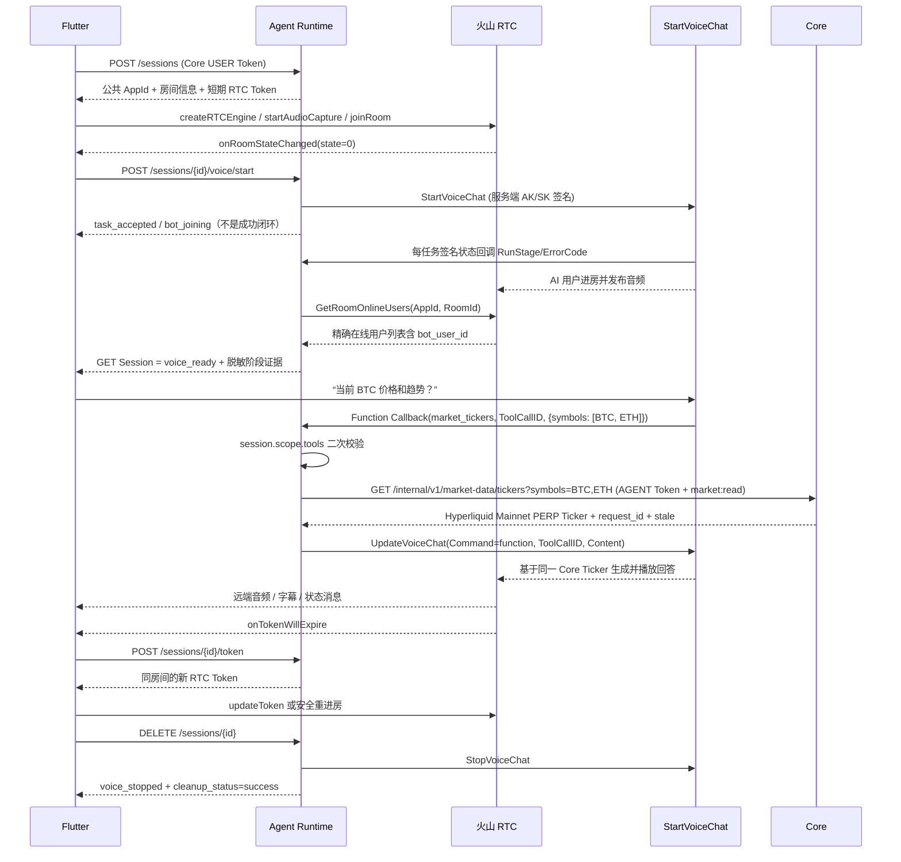

# 火山 RTC 实时语音时序



关键约束：

- 必须先收到进房成功回调，再调用 StartVoiceChat。
- Token 默认 10 分钟，有发布音频/视频/数据流和订阅权限；AppKey 仅在 Runtime HMAC。
- `StartVoiceChat` 的 HTTP 200 仅表示异步请求被接受。Session 依次进入
  `voice_starting/task_accepted/bot_joining`；ASR/LLM/TTS 回调不能单独提升为 ready。
- 只有服务端 `GetRoomOnlineUsers` 在相同 AppId/RoomId 中精确发现 `bot_user_id`，
  才进入 `voice_ready`；30 秒未发现进入 `bot_join_timeout`。
- 状态回调与 Function Callback 分别由独立 master secret 派生每个 Session/Task 的不透明
  HMAC 签名，并做常量时间比对，同时校验 AppId、RoomId、TaskId。日志只记录 Task/Room/User/Bot
  哈希、run_stage、error_code 和受约束 request/trace id；不记录 master/派生签名、RTC/S2S Token、
  AK/SK、完整 payload 或语音原文。旧任务只在迁移窗口继续接受旧静态签名，新任务不再把长期
  master 直接放入 StartVoiceChat 参数。
- 回调错误进入 `provider_failed`。普通 UI 只展示稳定的
  `voice_error_message=连接失败，请重试`；`voice_diagnostics` 单独保留首次失败阶段、
  脱敏 Provider 错误、Start request ID、presence request ID 与 callback trace。
- 回调事件按任务身份和事件指纹幂等；重复十次不会重复 Stop 或改写首次失败。
  失败/超时会及时 Stop，后续 DELETE 只标记会话已停止，不会第二次 Stop，也不会用
  `voice_stopped` 覆盖原始失败阶段和错误码。
- GET Session 同时暴露脱敏的 `voice_task_creation_result`、首次有效
  `voice_callback_received_at`、`voice_stopped_at` 与 `voice_cleanup_status`。这些字段可证明
  异步受理/回调/清理发生，但不能代替 Bot 进房、Transcript 或可听音频证据。
- Mobile 可把已展示的 transcript done 批量上报 `/history`；Runtime 只保存
  `voice_user_transcript_at/voice_assistant_transcript_at` 两个存在性时间证据，既不写 Session
  原文，也不把完整语音内容写日志。Provider 的音频开始和打断回调只分别记录
  `voice_provider_audio_started_at/voice_interrupted_at`，仍不能证明真机已经听到音频；
  可听音频与麦克风释放仍须真机证据。
- `voice_diagnostics` 逐段记录 start requested/accepted、taskStart、Bot presence、首个回调、
  用户音频状态（仅 provider 明示时为 `OBSERVED`，否则保持 `UNKNOWN`）、ASR、用户字幕、LLM、
  Function Call、TTS、助手字幕、provider audio、interrupt、stop 与 cleanup 时间。ASR/LLM/TTS
  进度不会被当成 Bot 进房证据，且乱序事件不会把失败/停止会话恢复为 ready。
- 火山会话状态回调的官方外层是 `message/binary/signature`；Runtime 只在内存中解码
  `conv + uint32 length + JSON` 信封，不保存完整 payload。`session_id` 和当前 Voice Task
  派生签名绑定 active attempt；Payload 中若出现 AppId/RoomId/TaskId，仍须严格匹配。
  `callback_schema_hash` 与 received/accepted/duplicate/stale 计数只用于脱敏诊断。
- Bot 已进房且欢迎语/远端音频已开始后，若 `AGENT_VOLC_ASR_SILENCE_TIMEOUT_SECONDS` 窗口内
  仍没有 ASR 或用户字幕，Session 保持可停止的 `voice_ready`，同时标记
  `VOICE_UPLINK_OR_ASR_SILENT`。Mobile 只展示“未检测到语音，请检查麦克风后重试。”；Runtime
  不自动重启 Bot、不创建第二个 Session，也不延长任务或创建 Draft。
- `OutputMode=1` 启用 S2S + Ark 混合编排。实时价格、24 小时涨跌和趋势必须调用
  `market_tickers`；Runtime 只通过 Core AGENT Token 请求内部 Ticker 接口，不传
  `user_id`，不保存 USER Token，也不直连 Hyperliquid。
- S2S 内置识别/合成配置位于 `S2SConfig.ProviderParams.asr/tts`。Runtime 默认使用
  800ms 判停、24kHz 单声道 PCM 和 `zh_female_vv_jupiter_bigtts`；不会再自动注入只有
  `ModelName`/`VoiceType` 的不完整顶层 `ASRConfig`/`TTSConfig`，以免请求同步受理后在
  火山异步参数校验阶段失败。
- Function Callback 与状态回调使用不同 URL/Secret；严格校验 AppId、RoomId、
  ToolCallID、工具名和 JSON arguments。火山 Function Callback 的 `TaskID` 是函数调用任务
  ID，不等于 VoiceChat TaskId；VoiceChat attempt 仍由派生签名绑定。工具结果使用官方
  `UpdateVoiceChat(Command=function)` 回灌，Content 是经过校验后序列化的结构化 JSON。
- Core AGENT Token 失效时 Function Callback 仍返回受控的工具错误给语音模型：
  `error_code=INTERNAL`、`message=智能体服务凭证暂不可用`，并只包含受约束的
  `upstream_code/request_id/retryable/credential_refresh_required`。不得回灌原始 Core
  body、JWT 或 traceback，也不得用模型记忆伪造行情；该故障会同步令 `/readyz` 返回 503。
- `StopVoiceChat` 幂等：成功后重复 DELETE 不会重复请求火山；失败时 Runtime 保留 Session、
  写入 `voice_cleanup_status=failed` 并返回错误，客户端可安全重试，避免遗留计费任务。
- Flutter 使用 `volc_engine_rtc 3.60.6`，订阅远端音频、不开摄像头。
- 字幕通过 `onSubtitleMessageReceived` 映射到现有 Voice UI 状态机。

当前代码层验证覆盖 Token 二进制向量、官方 Node SDK 签名向量、OpenAPI 请求形状、
Flutter 静态分析和单测；只有真机保存“用户语音 → User Transcript → Assistant Transcript →
可听语音 → Stop → 麦克风释放”证据后，才可把 `voice_e2e_verified` 改为 true。

---

## WebRTC 直连网关（控制面）

数据面（音频流）由客户端与云端大模型 WebRTC 直连，不经过 Runtime 转发；控制面的三件事
必须回到服务端。

### 1. 凭证签发（标准化出参）

`POST /v1/agent/sessions` 与 `POST /v1/agent/sessions/{id}/token` 返回的 `voice` 对象统一
包含 `provider` / `endpoint_url` / `client_secret` 或 `token` / `expires_at` / `allowed_tools`，
客户端只认这几个字段即可建链。

- `endpoint_url`：客户端建立媒体直连的入口。OpenAI 为
  `<AGENT_OPENAI_BASE_URL>/v1/realtime/calls`；火山 RTC 由原生 SDK 用
  `app_id/room_id/token` 进房，没有客户端可见的 HTTP 入口，故为 `null`。
- `allowed_tools`：本次通话允许触发的工具白名单。**它只是给客户端的提示**，服务端在
  执行时仍按会话 `scope.tools` 二次强校验，绝不信任客户端上报的工具名。

Provider 由 `app/voice/registry.py` 的不可变注册表按 `AGENT_REALTIME_VOICE_PROVIDER`
分发。新增一家（Gemini Live / Grok WebRTC 等）只需实现 `VoiceProvider` Protocol 并注册
工厂，容器与端点都不用改。

### 2. 主备容灾：按需领备用票

`POST /v1/agent/sessions/{id}/token` 支持可选的 `provider` 入参，缺省走部署配置的主力
渠道。客户端直连握手超时（约 3 秒）时带上备用渠道名领票，例如：

```json
{ "want": ["voice"], "provider": "volc_rtc" }
```

约束：

- 会话记录 `voice_provider_name`，此后 `voice/start`、`presence`、`StopVoiceChat`、
  Function Callback 回灌全部按它路由 —— 绝不会出现用新渠道去停旧任务。
- **会话仍有未清理的 provider 任务时不允许切换渠道**（`409 POLICY_VIOLATION`）：否则
  旧任务会在原 provider 侧继续计费。客户端应先 `DELETE /sessions/{id}` 再重开。
- 备用渠道装配不出来（缺凭证 / 未登记）返回受控的 `503 INTERNAL`，不会 500。
- 换渠道时会把新凭证的 `app_id/room_id/user_id/task_id/bot_user_id` 一并落库。

### 3. `POST /api/voice/tools/execute` —— 服务端风控执行

资金安全红线：AI 在直连通话中触发交易 Tool Call 时，客户端**严禁**在前端直接调交易所，
必须把指令原样 POST 回服务端。

```json
{ "session_id": "sess_x", "tool_call_id": "call_1", "name": "market_tickers",
  "arguments": {"symbols": ["BTC"]} }
```

鉴权用 Core USER Bearer Token；跨用户会话与不存在的会话统一塌成 `404 SESSION_NOT_FOUND`。
服务端按 `session.scope.tools` 二次校验 → 过 mandate/policies → 持 AGENT 凭证调 Core →
每次调用（含被拒绝的）都写审计。与 `/v1/agent/sessions/{id}/tool-calls` 共用同一条执行
路径（`app/api/tool_execution.py`），两条通道的风控口径不会漂移。返回标准 tool result，
客户端原样喂回大模型。下单类工具只返回 `trade_draft_id`，仍须用户确认，绝不自动执行。

### 4. `POST /api/voice/session/end` —— 挂断结账

```json
{ "session_id": "sess_x", "provider": "volc_rtc", "duration_seconds": 90,
  "usage_tokens": {"audio_tokens": 1500, "text_tokens": 500},
  "transcript_summary": "用户询问 BTC 走势，确认了一笔多单草案。" }
```

- **只记账，不停任务。** 它绝不把会话标成 `voice_stopped` + `cleanup_status=success` ——
  一旦提前置位，`DELETE /sessions/{id}` 会短路跳过 `StopVoiceChat`，在火山那边遗留一个
  计费中的任务。停止链路仍归 DELETE 独有。
- 按 `session_id` **幂等**：重复上报返回 `duplicate=true`，不重复扣费，摘要也只写一次。
- 计费口径：每 `AGENT_VOICE_BILLING_SECONDS_PER_UNIT` 秒一个时长单元 +
  每 `AGENT_VOICE_BILLING_TOKENS_PER_UNIT` 个 token 一个 token 单元，各自向上取整后相加。
  `AGENT_VOICE_QUOTA_UNITS_PER_USER=0` 表示不限额（此时不返回 `remaining_units`）。
- `transcript_summary` 写入与文字聊天共享的同一条记忆流（`source=voice`），挂断后回到
  聊天框继续打字不割裂。

> 计费账本目前是 Runtime 进程内实现（Core 尚无计费接口），多 worker 或重启会丢账。
> 正式上线前必须落 PG 或迁到 Core。

### 5. 文字 ↔ 语音记忆衔接

- **先打字后语音**：签发凭证与 `StartVoiceChat` 时，`ContextBuilder.build_voice_context`
  把用户画像与最近情景记忆（含上一通电话摘要）注入 Realtime Session。OpenAI 走
  `instructions`，火山追加一条 system message —— 配置的基础人设永远排在最前，不被覆盖。
- **先语音后打字**：`/api/voice/session/end` 的 `transcript_summary` 落进同一条记忆流。

---

## Gemini Live 原生音频（`gemini_live`）

`AGENT_REALTIME_VOICE_PROVIDER=gemini_live` 时启用。与 OpenAI 路径同类 ——
客户端直连、音频不经过 Runtime —— 但移动端要注意三处差异。

### 1. 传输是 WebSocket，不是 WebRTC

Gemini Live 官方没有原生 WebRTC（四个官方示例全是 WSS，WebRTC 只存在于
LiveKit / Pipecat 这类第三方桥接里）。**「音频不过服务器」这条架构约束不变**，
只是客户端换一种连法：接 WSS + 收发 PCM。

凭证下发的 `endpoint_url` 是**不含密钥**的规范地址（URL 会进日志与崩溃上报，
短期票绝不拼进去）。客户端自行拼接：

```
wss://generativelanguage.googleapis.com/ws/
  google.ai.generativelanguage.v1beta.GenerativeService.BidiGenerateContentConstrained
  ?access_token=<voice.client_secret>
```

⚠️ 端点必须是 v1beta 的 **`BidiGenerateContentConstrained`**。把短期票喂给标准的
`BidiGenerateContent` 会被拒成 `unregistered callers` —— 报错长得像凭证问题，
实际是端点选错了，很容易白排查一轮。

音频格式：输出 `audio/pcm;rate=24000`（24kHz 单声道 PCM）。

### 2. 人设与工具白名单锁在票里，客户端改不了

`Constrained` 端点执行的是**服务端签票时锁定的 setup**。实测：客户端连上后自带一份
篡改过 `systemInstruction` 的 setup，会被上游无视，模型仍然遵守服务端那份。

Runtime 通过 `POST /v1beta/auth_tokens` 签发受约束的单次短期票。Google SDK 将
该能力命名为 `liveConnectConstraints`；当前已验证可工作的 v1beta REST wire
字段是 `bidiGenerateContentSetup`，其中锁定：

| 锁定项 | 内容 |
|---|---|
| `model` | 固定 `gemini-3.1-flash-live-preview` |
| `config.responseModalities` | `["AUDIO"]`（原生音频模型不支持 TEXT） |
| `config.speechConfig.voiceConfig.prebuiltVoiceConfig.voiceName` | 固定 `Leda`，Runtime 签票与 Mobile setup 必须一致 |
| `inputAudioTranscription` / `outputAudioTranscription` | 开启，供 `/history` 字幕证据链 |
| `systemInstruction` | 基础人设 + 最近记忆上下文 |
| `tools.functionDeclarations` | Session scope 与 Runtime 只读白名单的交集；当前为 `market_tickers` / `get_market_price` |

这比 OpenAI Realtime 更硬：那边客户端可以用 `session.update` 改配置，这边物理上改不了。

客户端仍需发一次 `setup` 并真实等待 `setupComplete`。Runtime 不会把签票成功或
`voice/start` 接受当作这条 Mobile WebSocket 已连接的证据。

### 3. 短期票的两个有效期

| 字段 | 配置 | 含义 |
|---|---|---|
| `expireTime` | `AGENT_GEMINI_TOKEN_TTL_SECONDS`（默认 1800s） | 票本身的有效期 |
| `newSessionExpireTime` | `AGENT_GEMINI_SESSION_START_WINDOW_SECONDS`（默认 60s） | **还能用它开新会话**的窗口 |

第二个窗口故意留得很短：拿到票要立刻连。过了窗口但票还没过期，已建立的会话不受影响，
但断线重连必须先向 `/sessions/{id}/token` 续签。

Runtime 的 `voice` 对象同时返回 `expires_at`、`client_secret_expires_at` 和
`new_session_expires_at`。Mobile 缺少任一 Gemini 必需字段、看到 v1alpha 端点或旧
Gemini 2.5 模型时必须 fail-closed。

### 4. 工具 schema 方言

Gemini 的 `functionDeclarations.parameters` 用 OpenAPI 子集，不认
`additionalProperties` / `$schema` —— 带上会让签票直接 400（实测）。Runtime 在
转换时递归剔除，工具定义本身不用改。

### 落地前先跑连通性自检

```
uv run python scripts/check_gemini_live_connectivity.py
```

四步：凭证与模型 → 长期凭证连 Live → 签发短期票 → **短期票真能连**。
第三步返回 200 不代表第四步能过，脚本会把两者分开报。
