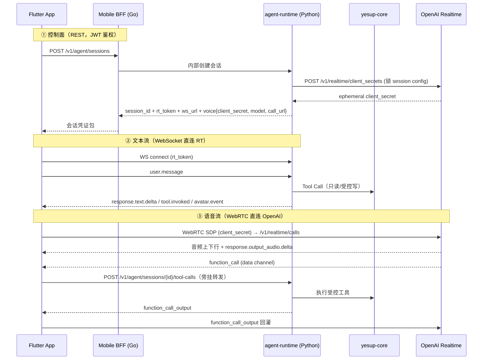

# 智能体 ↔ 移动端 接口设计（yesup-agent-runtime）

- 日期：2026-07-31
- 负责人：wesley
- 状态：设计已定稿，待评审
- 关联仓库：Repository 3 `yesup-agent-runtime`（Python 3.12 / FastAPI / Pydantic v2）
- 上游架构：`/Users/wesley/workspace/Architecture/README.md`（YesUP 产品技术落地方案）

---

## 1. 背景与目标

YesUP 是「统一账户 + AI 数字人 + 多协议交易执行」的移动端智能交易平台。`yesup-agent-runtime` 负责**数字人、语音、智能体编排、业务工具调用**，是产品差异化的交互入口，但**不持有资金写权限、不直连交易所**——所有真实执行必须回到 `yesup-core` 走风控、确认、幂等。

本设计定义 **Flutter App（Repository 1）↔ agent-runtime（Repository 3）** 之间的完整接口契约，作为移动端同事对接的唯一事实来源。第一版覆盖：会话生命周期、文本对话、实时语音、数字人事件、工具调用可见性。

## 2. 关键决策与权衡

| # | 决策 | 结论 | 理由 |
|---|---|---|---|
| D1 | 通信拓扑 | 控制面 REST 走 BFF 鉴权中转；实时媒体/事件用短期凭证直连 | README「客户端通过后端申请短期会话凭证」；App 不持长期密钥 |
| D2 | 功能范围 | 全覆盖（会话+文本+语音+数字人事件+工具可见性） | 一次性把契约定清，避免移动端反复返工 |
| D3 | 交付形式 | Markdown 主文档 + 内嵌 OpenAPI 3.1 片段 | REST 用 OpenAPI；WebRTC/WS 用时序图和事件字典 |
| D4 | 语音拓扑 | **方案 B：App 短期 token 直连 OpenAI WebRTC；RT 服务端锁 session；工具执行旁挂回 RT** | 见 §2.1 权衡 |

### 2.1 语音拓扑的权衡（D4 详述）

曾评估三条路线：

- **A 纯代理**：App→RT(aiortc)→OpenAI。RT 完全掌控音频流。**代价**：Python 端需自建 WebRTC 服务端（SDP/ICE/DTLS/SRTP/Opus/抖动缓冲），`aiortc` 生产稳定性风险高，两周 MVP 落地风险大。
- **B 务实直连**（采纳）：App 用短期 `client_secret` 直连 OpenAI WebRTC；RT 在签发凭证时**锁死 session config**（tools 白名单、instructions、model、reasoning.effort）；OpenAI 经 data channel 把 `function_call` 事件发给 App，App **不执行**，旁挂转发给 RT 轻端点，RT 调 core 后回灌 `function_call_output`。
- **C 分阶段**：契约按代理写，第一周只实现文本，语音后置。

**采纳 B 的核心依据**：README 红线是「agent 写工具只创建 `TradeDraft`，真实执行必过 core 二次确认」。因此「工具在客户端还是服务端执行」的安全权重被 core 的二次确认兜底——即使 App 绕过旁挂，也只能拿到待确认草案，碰不到资金。这让 B 在**免掉 Python WebRTC 服务端大坑**的同时不破安全红线。数字人口型（viseme）需要音频流，直连下 RT 拿不到，但 README 明确允许数字人第一阶段降级，故口型后置。

## 3. 通信拓扑



### 3.1 三条通道分工

| 通道 | 协议 | 谁连谁 | 用途 |
|---|---|---|---|
| 控制面 | HTTPS REST | App → **BFF** → RT | 创建/关闭会话、签发/续签凭证、查历史、文本单轮（可选） |
| 文本流 | WebSocket | App → **RT 直连** | 流式文本对话、工具调用可见性、数字人事件 |
| 语音流 | WebRTC | App → **OpenAI 直连** | 音频上下行；工具事件旁挂回 RT |
| 工具旁挂 | HTTPS REST/WS | App → **RT 直连** | 语音场景下把 OpenAI 的 function_call 转发给 RT 执行 |

## 4. 鉴权与短期凭证

- App 只持有 YesUP 主 JWT，**永不接触** OpenAI key 或长期 RT token。
- 创建会话：BFF 校验 JWT → 调 RT → RT 同时产出两类凭证：
  - `rt_token`：短期 JWT（~5min），绑定 `session_id + user_id + scope`，用于 WS 文本流和工具旁挂。
  - `voice.client_secret`：OpenAI ephemeral token（~60s），仅用于 App→OpenAI WebRTC 握手；session config（tools/instructions/model）由 RT 在签发时锁死，App 无法篡改。
- 过期续签走 `POST /v1/agent/sessions/{id}/token`。
- `scope` 决定该会话可用的 Agent 类型与工具白名单（对应 README 的 `AgentMandate`）。

## 5. REST 控制面接口（经 BFF）

```
POST   /v1/agent/sessions                 创建会话，返回凭证包 + endpoints
GET    /v1/agent/sessions/{id}            会话状态
DELETE /v1/agent/sessions/{id}            结束会话
POST   /v1/agent/sessions/{id}/token      续签短期凭证
POST   /v1/agent/sessions/{id}/tool-calls 语音工具旁挂执行
POST   /v1/agent/messages                 文本单轮（非流式，简单场景）
GET    /v1/agent/sessions/{id}/history    对话历史（cursor 分页）
```

规范：统一错误 `{code, message, details, trace_id}`；写请求支持 `Idempotency-Key`；时间 UTC ISO 8601；金额字符串；版本 `/v1`；分页 cursor。

## 6. 文本对话 WebSocket 事件

- 上行：`user.message` / `user.interrupt` / `ping`
- 下行：`response.text.delta` / `response.text.done` / `tool.invoked` / `tool.result` / `avatar.event` / `session.state` / `error`

## 7. 语音会话（方案 B：直连 + 旁挂）

- App 用 `voice.client_secret` 向 OpenAI `/v1/realtime/calls` 发 SDP，建 WebRTC。
- session config 由 RT 在 `client_secrets` 创建时通过 `session.update` 语义锁定：`model=gpt-realtime-2.1`、`reasoning.effort=low`、tools 白名单、system instructions。
- OpenAI 经 data channel 下发 `function_call`；App 转发 `POST /v1/agent/sessions/{id}/tool-calls` 给 RT；RT 调 core，返回 `function_call_output`；App 回灌 OpenAI。
- transcript/字幕/打断由 OpenAI 直接经 data channel 给 App（`response.output_audio_transcript.delta` 等），App 本地驱动状态机。
- **审计**：RT 通过工具旁挂路径记录每次 tool call（`trace_id/session_id/tool_name/args_hash/result_ref`），满足 README 要求；完整语音 transcript 审计后置。

## 8. 数字人事件

- 文本流场景：RT 经文本 WS 下发 `avatar.event`（`emotion/gesture/state`）。
- 语音流场景：口型 viseme 后置（直连下 RT 无音频流）；状态机（Idle/Listening/Thinking/Speaking）由 App 根据 WebRTC 连接状态与 OpenAI 事件本地自驱。
- App 无数字人 SDK 时可降级为纯语音/文本，事件可忽略。

## 9. 工具调用可见性与安全红线

- Agent 下单类工具只创建 `TradeDraft`，**不执行**。
- 可见性流：`tool.invoked{name, args_summary}` → `tool.result{trade_draft_id}` → App 拉起 core 的确认页（`yesup-core` 的 `/v1/trade-drafts/{id}/confirm`，**不在 agent 通道确认**）。
- 守住 README「模型输出不是授权」「真实执行必过 core」红线。

## 10. 错误模型与可观测性

- 统一错误信封 `{code, message, details, trace_id}`。
- 每会话贯穿 `trace_id`；每次 tool call 记录 `session_id/tool_name/args_hash/result_ref`。
- WS 断线重连：重连后 App 用 REST 拉取 `session.state` 补齐。
- OpenTelemetry：LLM latency / voice session connect rate / tool call 成功率。

## 11. 文档产物结构

```
docs/
├── superpowers/specs/2026-07-31-agent-mobile-interface-design.md  (本设计)
└── api/agent-mobile/
    ├── README.md              主接口文档（人读，含时序图、事件表、错误码）
    ├── openapi.agent.yaml     REST 控制面 OpenAPI 3.1 片段
    ├── ws-events.md           WebSocket 事件字典（上下行 + payload schema）
    └── voice-webrtc.md        语音 WebRTC 握手与工具旁挂时序
```

## 12. 技术栈调研结论（OpenAI Realtime，截至 2026-07）

- GA 模型：`gpt-realtime-2.1` / `gpt-realtime-2.1-mini`（2026-07-06 发布，带 reasoning，生产语音建议 `reasoning.effort=low`）。
- 三种传输：WebRTC（浏览器/移动端直接采播）、WebSocket（服务端已有裸音频时）、SIP（电话）。
- 短期凭证：`POST /v1/realtime/client_secrets`；WebRTC 走 `/v1/realtime/calls`。
- 服务端直连：WebSocket + `OpenAI-Safety-Identifier` 头。
- GA 事件名：`session.update` / `input_audio_buffer.*` / `response.output_audio.delta` / `response.output_audio_transcript.delta` / 函数调用事件；旧 `OpenAI-Beta: realtime=v1` 头需去除。
- 结论：方案 B 的「App WebRTC 直连 + 服务端锁 session + 工具旁挂」是官方支持的标准客户端模式。

## 13. 非目标（第一版不做）

- 数字人 3D 口型 viseme（后置，可降级）。
- 完整语音 transcript 服务端审计（先只审计 tool call）。
- SIP / 电话入口。
- Monitor / Fund Manager Agent 的自动执行（第一阶段只告警/只分析）。
- 无人值守交易。
> **历史设计，已于 2026-08-07 被火山 RTC 主链路取代。** 当前实现与契约请以
> `docs/api/agent-mobile/` 为准；OpenAI 只保留为可选兼容 Provider。
